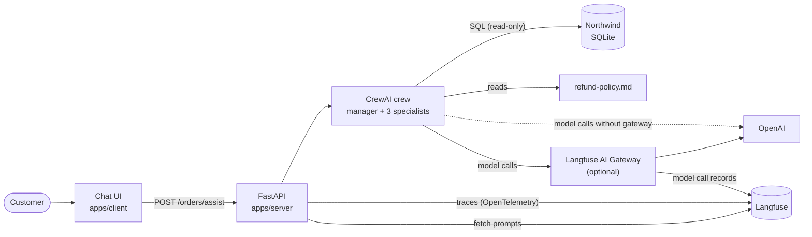

# Langfuse CrewAI Agent Demo

A small, complete AI agent app for learning how to build, observe and operate agents with
[Langfuse](https://langfuse.com). A [CrewAI](https://www.crewai.com) crew answers customer
questions about orders and refunds for a fictional shop, using the classic Northwind database.
Every part of it is wired to Langfuse:

- **Tracing**: each request becomes one trace with a span for every agent step, tool call and
  model call, so you can see exactly how the agents reached an answer.
- **AI Gateway**: model calls can go through the Langfuse AI Gateway, which holds the provider
  key and records model, tokens and cost for each call.
- **Prompt management**: all prompts live in Langfuse, so you can edit and version them without
  touching the code, and every trace shows which prompt versions produced the answer.

| App | Description |
| --- | --- |
| [`apps/server`](apps/server) | FastAPI service with the CrewAI crew that answers customers' questions about their orders and refunds. |
| [`apps/client`](apps/client) | Vite + React + assistant-ui chat interface for testing the server API. |

## How it works



### One request, step by step

Take the message *"I am Carine Schmitt from France Restauration. I want to refund order 14288.
It arrived too late"*:

1. **The chat UI sends the message.** The client posts it to `POST /orders/assist`. The server
   keeps no conversation history, so each message must say who the customer is.
2. **The server fetches the prompts from Langfuse.** The task, the expected answer and each
   agent's role, goal and backstory are Langfuse prompts labelled `production`
   (`crew/prompts.py`). The Langfuse SDK caches them, so most requests don't wait on the network.
3. **The server builds a fresh crew** (`crew/crew.py`). This is a hierarchical crew: a manager
   agent plans the work and delegates it to three specialists, each with its own tools:
   - **Order details specialist**: `get_order_details`.
   - **Order search specialist**: `search_orders`, optionally within a date range.
   - **Refund policy specialist**: `read_refund_policy`, `get_order_details` and
     `calculate_refund_amount`.
4. **The agents call tools** (`crew/tools.py`). The tools query the database through
   SQLAlchemy and return JSON facts such as dates, days late, items and prices. They never write
   to the database. The first customer a request identifies is locked in, so the agents can't
   see another customer's orders, even if the message asks them to.
5. **The refund decision comes from a document.** The refund specialist reads
   `apps/server/docs/refund-policy.md` on every request and applies it to the order's facts. The
   amount always comes from `calculate_refund_amount`, never from the model's own arithmetic.
   To change the rules, edit the Markdown file; no code changes.
6. **Each model call goes to the LLM**, through the Langfuse AI Gateway when it's configured, or
   directly to OpenAI otherwise (`make_llm` in `crew/crew.py`).
7. **The manager writes the reply**, and the server returns it as `{"answer": "..."}`. If the
   crew can't run (for example the prompts or model key are missing), it returns
   `503 {"error": "..."}`.

Meanwhile, the whole run is recorded in Langfuse as one trace.

### What Langfuse shows you

**Tracing** (`observability.py`). At startup, the server creates the Langfuse client and
instruments CrewAI with [OpenInference](https://github.com/Arize-ai/openinference), following the
[Langfuse CrewAI guide](https://langfuse.com/integrations/frameworks/crewai). Each request is
wrapped in an `order-assistant` span. In the Langfuse UI you get one trace per request: the
customer's message as input, the answer as output, and nested spans for the crew, the task,
each agent's turns, every delegation and every tool call with its arguments and result. This is
where you debug the agent: why it picked an order, which policy rule it applied, or which tool
returned an error.

**AI Gateway** (`make_llm` in `crew/crew.py`). Set `LANGFUSE_GATEWAY_HOST` and
`LANGFUSE_GATEWAY_KEY`, and CrewAI sends every model call to the gateway's OpenAI-compatible
endpoint instead of OpenAI. The gateway holds the provider's API key, so the app never needs
one, and it records each call's model, tokens and cost. Every call carries the current span's
W3C `traceparent` header, so the gateway nests its record inside the same trace as the agent
step that made the call.

**Prompt management** (`crew/prompts.py`). The crew has no prompt text in its code. The
prompts ship with the project in `apps/server/src/langfuse_agent_demo/crew/prompts.toml`, and
`make -C apps/server prompts-push` creates them in your Langfuse project. After that, edit them
in Langfuse: a change reaches the crew without a restart, after the SDK's 60-second cache
refreshes. The trace's metadata lists the version of every prompt used, so you can compare
answers across prompt versions. Prompts are checked when fetched: an edit that the crew couldn't
run, such as an unknown `{{variable}}`, is rejected with a clear error instead of breaking a run
halfway through.

## Quick start

You need Python 3.13 with [uv](https://docs.astral.sh/uv/), Node.js with npm, a
[Langfuse](https://cloud.langfuse.com) project (its public and secret API keys), and either an
OpenAI API key or a Langfuse AI Gateway key with an OpenAI connection named `openai`.

```bash
make install                          # install both apps' dependencies
cp apps/server/.env.example apps/server/.env
# Edit apps/server/.env: set LANGFUSE_PUBLIC_KEY, LANGFUSE_SECRET_KEY and LANGFUSE_BASE_URL,
# then either LANGFUSE_GATEWAY_HOST + LANGFUSE_GATEWAY_KEY, or OPENAI_API_KEY.
make -C apps/server prompts-push      # create the crew's prompts in your Langfuse project
make server                           # http://localhost:8000
make client                           # http://localhost:5173, in a second terminal
```

Open the chat UI and click one of the sample messages, then open your Langfuse project to see
the trace. `apps/server/.env.example` sets `CURRENT_DATE=2023-11-20`, close to the newest
orders in the database, so the refund windows in the samples behave as described in the
[server README](apps/server/README.md#test-prompt).

## Things to try

- **Follow an answer through its trace.** Send the late-delivery refund above and find, in the
  trace, the tool call that reported the order was 3 days late and the policy text the refund
  specialist read.
- **Change a prompt in Langfuse.** Edit `order-assistant/expected-answer`, for example to ask
  for a shorter reply, and save it as a new `production` version. Send a couple of messages and
  check that the trace metadata shows the new version. `make -C apps/server prompts-push
  ARGS=--force` resets the prompts to the shipped text.
- **Change the business rules.** Edit `apps/server/docs/refund-policy.md`, for example shorten
  the late-delivery window, and ask again. The crew applies the new rule without a restart.
- **Turn the gateway on and off.** Compare traces with and without `LANGFUSE_GATEWAY_*`: with
  the gateway, model calls appear with tokens and cost inside the agent spans.
- **Try to break it.** Ask about another customer's order, or give a refund request without an
  order ID, and watch how the agents and the customer lock respond.
- **Watch it live in the console.** `CREW_VERBOSE=true` (the `.env.example` default) prints each
  agent step, delegation and tool call to the server's console.

## Make targets

Run from the repository root. `install`, `test` and `format` run the same target in every app:

```bash
make install   # install dependencies
make test      # format check, lint, type-check, then tests
make format    # fix formatting and lint issues
make server    # start the server (http://localhost:8000)
make client    # start the chat UI (http://localhost:5173), in a second terminal
```

Each app can also be run on its own from its folder. Its README has all settings and details:
[server](apps/server/README.md), [client](apps/client/README.md).
